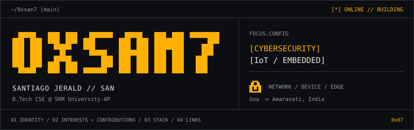

<!-- 01 // IDENTITY -->
<picture>
  <source media="(max-width: 600px)" srcset="assets/profile-header-mobile-v3.svg">
  
</picture>

[`interests`](#02--interests_and_contributions) / [`contributions`](#02--interests_and_contributions) / [`stack`](#03--stack_and_tools) / [`contact`](#04--contact_and_links)

B.Tech CSE at SRM University-AP. From Goa, based in Amaravati. Interested in cybersecurity, IoT, and the systems connecting networks, devices, and edge computing.

---

<a id="02--interests_and_contributions"></a>

| Interested tech domains | Contributions |
| :--- | :--- |
| **`[01] CYBERSECURITY`**<br>Network security, SOC tooling, software supply-chain security, explainable threat detection. | **[Activity log](https://github.com/0xsan7#js-contribution-activity-description)**<br>Live public contribution activity. |
| **`[02] IoT / EMBEDDED`**<br>Microcontrollers, connected devices, sensor data, TinyML / Edge AI, RF coverage and simulation. | **[Pull requests](https://github.com/search?q=author%3A0xsan7+is%3Apr&type=pullrequests)** / **[Issues](https://github.com/search?q=author%3A0xsan7+is%3Aissue&type=issues)**<br>Authored PRs and issue discussions. |

```text
INTEREST MAP

network  -------->  device  -------->  edge
security             IoT              TinyML
```

---

<a id="03--stack_and_tools"></a>

| Layer | Tech stack |
| :--- | :--- |
| Languages | `Go` / `C` / `C++` / `Python` / `JavaScript` |
| Web | `Node.js` / `Express` / `HTML` / `CSS` / `Canvas` |
| Embedded | `ESP32` / `STM32` / `Arduino` / `Raspberry Pi` / `Jetson Nano` |
| ML / Edge | `SHAP` / `Gemma` / `TinyML` / `Edge Impulse` |
| Workflow | `GitHub Actions` / `Fuzz testing` / `CLI tooling` |

---

<a id="04--contact_and_links"></a>

[**`[github]`**](https://github.com/0xsan7) [**`[X / @0xsan7]`**](https://x.com/0xsan7) [**`[linkedin]`**](https://www.linkedin.com/in/santiago-jerald-6bb082381/)

```text
END OF FILE                                             0xsan7(1)
```
