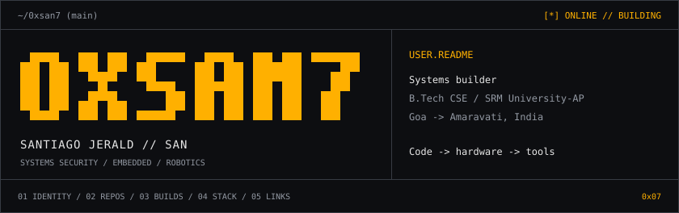

<!-- 01 // IDENTITY -->
<picture>
  <source media="(max-width: 600px)" srcset="assets/profile-header-mobile.svg">
  
</picture>

[`projects`](#02--projects_and_repos) / [`builds`](#03--hardware_and_builds) / [`stack`](#04--stack_and_tools) / [`links`](#05--contact_and_links)

I build security tools, embedded systems, and browser-based utilities. B.Tech CSE at SRM University-AP. From Goa, based in Amaravati.

---

<a id="02--projects_and_repos"></a>

| `~/src/` | Specification |
| :--- | :--- |
| **[Argus](https://github.com/0xsan7/Argus)**<br>`Python / SHAP / Gemma` | Local SOC console. ML threat prediction, explainable risk attribution, local LLM triage.<br>`[!]` 3rd runner up / Sudo Hacktober (MLH). [Demo / post](https://x.com/0xsan7/status/2110587250711072974). |
| **[SCRAM](https://github.com/0xsan7/SCRAM)**<br>`Go / Supply-chain security` | Fail-closed dependency auditing. Six lockfile ecosystems. PR dependency diffs.<br>`v0.1.0` / [Go docs](https://pkg.go.dev/github.com/0xsan7/scram/cmd/scram) / [Release](https://github.com/0xsan7/SCRAM/releases/tag/v0.1.0). |
| **[Spectrum Mapper](https://github.com/0xsan7/spectrum-mapper)**<br>`Node.js / Canvas / RF` | 2.4 GHz coverage simulation. Path loss, wall attenuation, RSSI trilateration.<br>`v1.1.0` / [Live demo](https://spectrum-mapper-demo.onrender.com) / [Build thread](https://x.com/0xsan7/status/2105906934494732436). |
| **[ASCII Art Generator](https://github.com/0xsan7/ascii-art-generator)**<br>`Python / JS / CLI` | Images and text -> monochrome character matrices. Terminal-ready output. |

---

<a id="03--hardware_and_builds"></a>

```text
~/workbench/
|
+-- PulseGuard
|   ESP32 + MPU6050 / C++ / TinyML
|   Machine-vibration anomaly detection. Inference on-device.
|
+-- High-speed line tracker
|   ESP32 + QTR-8RC + N20 motors + TB6612FNG
|   Eight-channel reflectance sensing. Closed-loop PID control.
|
`-- Polaroid audio-lyric app
    HTML + CSS + JavaScript / Web Audio API
    Photo gallery. Timestamp-synchronized audio and lyrics.
```

---

<a id="04--stack_and_tools"></a>

| Layer | Tools |
| :--- | :--- |
| Languages | `Go` / `C` / `C++` / `Python` / `JavaScript` |
| Web | `Node.js` / `Express` / `HTML` / `CSS` / `Canvas` |
| Boards | `ESP32` / `STM32` / `Arduino` / `Raspberry Pi` / `Jetson Nano` |
| Components | `MPU6050` / `QTR-8RC` / `TB6612FNG` / `N20 motors` |
| ML / Edge | `SHAP` / `Gemma` / `TinyML` / `Edge Impulse` |
| Workflow | `GitHub Actions` / `Fuzz testing` / `CLI tooling` |

```text
FOCUS  Network + supply-chain security
       Embedded systems + robotics
       TinyML + Edge AI / RF simulation
```

---

<a id="05--contact_and_links"></a>

[**`[build.log / X]`**](https://x.com/0xsan7) [**`[linkedin]`**](https://www.linkedin.com/in/santiago-jerald-6bb082381/) [**`[go.pkg / SCRAM]`**](https://pkg.go.dev/github.com/0xsan7/scram/cmd/scram)

Build notes and demos on X. Project source and documentation linked above.

```text
END OF FILE                                             0xsan7(1)
```
